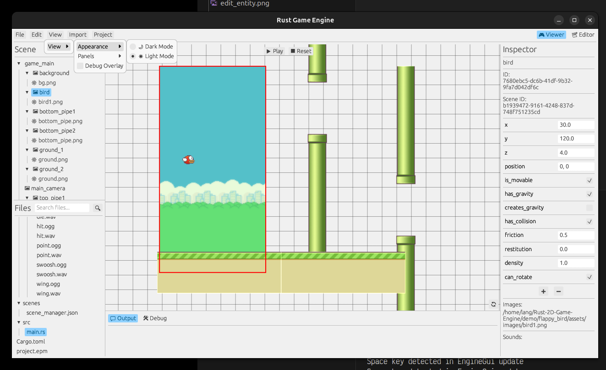
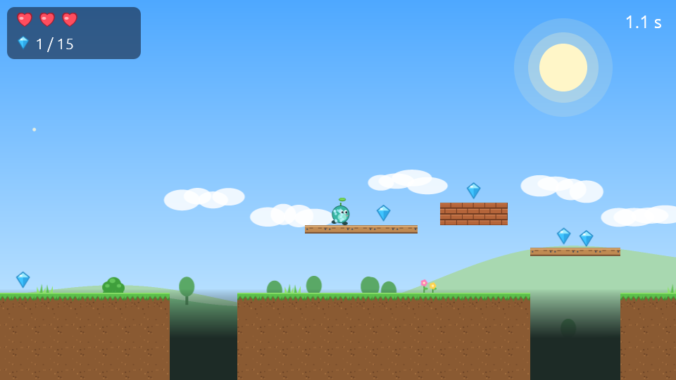

# Rust 2D Game Engine

[](https://github.com/gh0stintheshe11/Rust-2D-Game-Engine/actions/workflows/ci.yml)
[](LICENSE)

A lightweight 2D game engine with a built-in visual editor, written in Rust.
Build scenes in the editor, write game logic in Lua, let
[rapier2d](https://rapier.rs) handle the physics, and export your game as a
standalone executable.



## Features

| Area | What you get |
|---|---|
| Editor | Scene hierarchy, inspector, file browser, Lua script editor with live syntax checking and an API palette, click-to-select and drag-to-move in the viewport, tilemap painting, undo/redo, play/pause/reset, console |
| Scenes | Scenes made of entities with named, typed attributes (numbers, booleans, strings, vectors); saved as portable JSON. Tilemaps (grids of tiles from a tileset image). Games switch scenes while playing (title screen, levels) and spawn copies of template entities (prefabs) |
| Physics | rapier2d bodies and colliders built from entity attributes: dynamic, kinematic and fixed bodies, rotation, gravity scale, gravity fields, trigger zones, collision layers, raycasts, collision events; tilemaps collide as one smooth surface, with one-way platforms |
| Scripting | Lua 5.4 scripts per entity with `init` / `update` / `on_collision` / `on_collision_end` hooks, save data kept between runs, hot reload while playing, and a sandbox |
| Rendering | Sprites with rotation, scale, z-order, mirroring, opacity and tint; sprite sheet animation; tilemaps, drawing only the tiles on screen; particles; text, panels, images and buttons over the game; camera framing with letterboxing |
| Audio | Sound effects and looping music with per-sound and master volume (wav, ogg, mp3, flac); runs fine without an audio device |
| Export | One click builds a standalone game for your platform |

## Getting started

```bash
# Linux (Debian/Ubuntu) build dependencies; macOS and Windows need none
sudo apt-get install -y build-essential pkg-config libasound2-dev \
  libx11-dev libxi-dev libxcursor-dev libxrandr-dev \
  libxkbcommon-dev libgl1-mesa-dev libwayland-dev

git clone https://github.com/gh0stintheshe11/Rust-2D-Game-Engine
cd Rust-2D-Game-Engine
cargo run --release            # launches the editor
```

Requires Rust 1.95 or newer. Prebuilt editor binaries for Linux, Windows and
macOS (Apple Silicon) are attached to each
[GitHub release](https://github.com/gh0stintheshe11/Rust-2D-Game-Engine/releases).
Building games from the editor needs the Rust toolchain
([rustup](https://rustup.rs)) either way.

On WSLg, if the window loses its connection (`Broken pipe`) after a while, run
through X11 instead: `WAYLAND_DISPLAY= cargo run --release`.

### Try the demos

Two small games made with the engine:

- [Hilltop Hop](demo/hilltop_hop/), a platformer: run and jump across a
  tilemap level, collect the gems and reach the flag. It shows one-way
  platforms, breakable bricks, particles, a gamepad, and a menu and HUD made
  with the game UI functions.
- [Star Catcher](demo/star_catcher/): catch the falling stars, dodge the
  rocks.



- In the editor: **File → Open Project** → `demo/hilltop_hop` (or
  `demo/star_catcher`), then **▶ Play**.
- Standalone: `cargo run -p hilltop_hop` (or `-p star_catcher`).

### Make your own game

1. **File → New Project** and pick an empty folder. The project starts with
   a scene and a camera.
2. Import images, sounds and scripts with the **Import** menu, create entities
   with **➕** in the scene panel, and attach assets from an entity's context
   menu.
3. Add physics through the "Physics" entity template, or by adding attributes
   such as `has_gravity` and `collider_width` in the inspector.
4. Write a script and attach it to an entity:

   ```lua
   function update(scene_id, entity_id)
       if is_key_just_pressed("Space") then
           local jump = get_attribute(scene_id, entity_id, "jump_velocity") or -260
           set_velocity(entity_id, 0, jump)
       end
   end
   ```

5. **▶ Play** to test, then **Project → Build Project**. The finished game is
   in `<project>/target/release/`.

## Documentation

[docs/](docs/README.md) has a design document for every module, describing
how it works today and its known limitations. Start with
[Lua scripting](docs/scripting.md) for the script API, and [Editor](docs/editor.md)
for the editor.

## Project layout

| Path | Contents |
|---|---|
| `src/` | The engine library (`rust-2d-game-engine`), linked into every game |
| `editor/` | The editor application (`rust-2d-game-editor`) |
| `demo/` | The demo games: `hilltop_hop/`, `star_catcher/` |
| `docs/` | Module documentation |
| `tests/` | Engine integration tests |

## Contributing

Contributions are welcome. [CONTRIBUTING.md](CONTRIBUTING.md) explains the
setup, the checks every change must pass, and the commit conventions;
[CHANGELOG.md](CHANGELOG.md) lists what changed between releases.

Releases are made by bumping `version` in the root `Cargo.toml` and pushing a
matching `v<version>` tag; [release.yml](.github/workflows/release.yml) tests,
builds and publishes the editor binaries.

## Status

The engine is young and its API small. The "Known limitations" sections of
the [docs](docs/README.md) list what's missing per module.

## License and credits

Licensed under the [Apache License, Version 2.0](LICENSE). If you distribute
the engine or a game built with it, include the license and the attribution in
[NOTICE](NOTICE); the editor's Build command puts both next to your game.

Originally created as a university course project (ECE 1724, University of
Toronto, 2024) by [Lang Sun](https://github.com/gh0stintheshe11),
[Feiyang Fan](https://github.com/feiyangfan) and
[Frank Chen](https://github.com/frankjc2022); see the
[archived course report](docs/archive/course_report.md).
