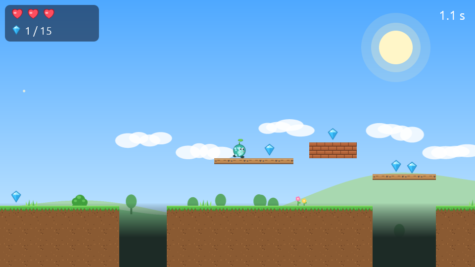

# Hilltop Hop

A small platformer made with the Rust 2D Game Engine. Run and jump across a
grassy hillside, collect the 15 gems, and reach the flag at the end. Pits
and spikes cost a heart; with all three gone, the round is over. The title
screen shows your best time, which is saved between runs.

**Controls:** ← / → or A / D to run, Space, W or ↑ to jump (hold for a
higher jump), ↓ or S to drop through a wooden plank. A gamepad works too:
the left stick or d-pad runs and drops, (A) jumps.
Esc (or Start) returns to the title screen. In the menus, the arrow keys or
the d-pad choose a button and Enter or (A) presses it, or click it; on the
end screens, Esc or (B) also goes to the title screen. These keys and
buttons are the project's input actions: change them with Project → Input
Actions in the editor.

## Running it

- **In the editor:** File → Open Project → this folder, then ▶ Play.
- **As a standalone game:** `cargo run -p hilltop_hop` from the repository,
  or Project → Build Project in the editor.

## What it shows

| Feature | Where |
|---|---|
| A tilemap level painted from one tileset: solid ground and stone, one-way wooden planks you jump up through (and drop through with down: `drop_through_platforms` in `player.lua`), and grass and flowers that don't collide | `ground` entity in the `level` scene (Tilemap section of the inspector) |
| Animated tiles: grass and flowers sway in the wind | the `ground` tilemaps' tiles 5 and 6 (their animation, below the palette) |
| A tilemap as a trigger zone: spikes | `spikes` entity (`is_sensor`), `player.lua` |
| Changing tiles from a script: bricks break when hit from below | `break_bricks` in `player.lua` (`get_tile_cell`, `get_tile`, `set_tile`) |
| Platformer movement on a dynamic body: run speed with `set_velocity` / `get_velocity`, ground checks with `raycast`, coyote time, jump buffering, short hops | `player.lua`, tuned by the `speed` and `jump_speed` attributes |
| Sprite sheet animation and mirroring | `player` entity (`frame_size`), `play_animation` and `flip_x` in `player.lua` |
| Particles: pollen in the air, and bursts of dust, brick debris, sparkles and confetti | the `pollen`, `dust`, `debris`, `sparkle` and `confetti` emitters, `emit_particles` in the scripts |
| Game UI: hearts and gem count, end screens with buttons, the title menu; buttons chosen with the keyboard or a gamepad, with a default button | `level.lua`, `title.lua` (`draw_rect`, `draw_image`, `draw_text`, `button` and its `default` option) |
| Input actions: keyboard and gamepad controls behind names (`left`, `right`, `jump`, `down`, `menu`, `back`); the stick runs as far as it's pushed, and has to be pushed well down to drop through a plank | `project.epm` (Project → Input Actions), `read_input` in `player.lua` (`get_action_axis`, `is_action_just_pressed`), `level.lua`, `title.lua` |
| Tweens and the `on_destroy` hook: gems bob with a looping tween and sparkle as they're removed; a checkpoint's flag hops when reached | `gem.lua` (`tween`, `on_destroy`), `checkpoint.lua` (`tween` and its `on_done`) |
| A camera following the player, with the sky and slower hills behind it (parallax) | `follow_player` in `level.lua` |
| Trigger zones with collision hooks: gems, checkpoints, the goal | `gem.lua`, `checkpoint.lua`, `goal.lua` |
| State shared by scripts and kept between runs: hearts, gems, the best time | `script_state`, `save_data` / `load_data` in `goal.lua` and `title.lua` |

## Assets

All images and sounds in `assets/` were generated for this project and are
covered by the repository's license (Apache-2.0).
