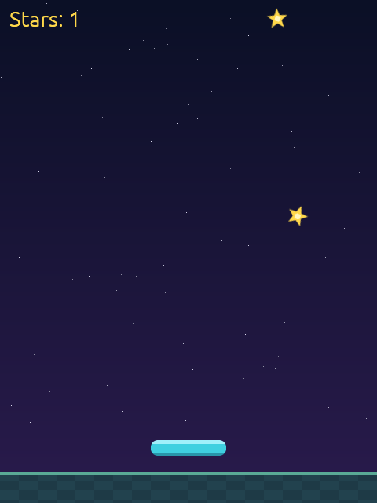

# Star Catcher

A small demo game for the Rust 2D Game Engine. Stars and rocks fall from the
sky: catch the stars with the paddle, and don't let a rock hit it. Drops come
faster over time, and the title screen remembers your best score.

**Controls:** ← / → or A / D to move. Space starts a game; after a game
over, Space plays again and Esc returns to the title screen.

## Running it

- **In the editor:** File → Open Project → this folder, then ▶ Play.
- **As a standalone game:** `cargo run -p star_catcher` from the repository
  root, or Project → Build Project in the editor (the game ends up in
  `target/release/`).

## What it shows

| Feature | Where |
|---|---|
| Several scenes: a title screen that starts the game (`change_scene`), and a round that restarts by changing to its own scene | `title` scene, `title.lua`, `spawner.lua` |
| State that survives scene changes: the best score | `script_state` in `falling.lua`, `title.lua` |
| Prefabs: stars and rocks are designed in a scene that never plays, and copied with `spawn` | `prefabs` scene, `spawner.lua` |
| Collision layers: falling objects (layer 2) pass through each other | `star` and `rock` prefabs (`collision_layer`, `collides_with`) |
| Kinematic body moved by a script, tuned by an attribute (`speed`) | `paddle` entity, `paddle.lua` |
| `on_collision`, removing entities, sounds | `falling.lua` |
| Explicit collider sizes on entities without images (the side walls) | `left_wall`, `right_wall` |
| Global gravity from a script, random seeds from an attribute | `spawner.lua` (`seed` = 0 is random) |
| Text over the game: the score, the title and game over screens, drawn every frame | `spawner.lua`, `title.lua` (`draw_text`) |
| Camera framing: a 480 × 640 frame centered on the camera entity | `main_camera` |

## Assets

All images and sounds in `assets/` were generated for this project and are
covered by the repository's license (Apache-2.0).
