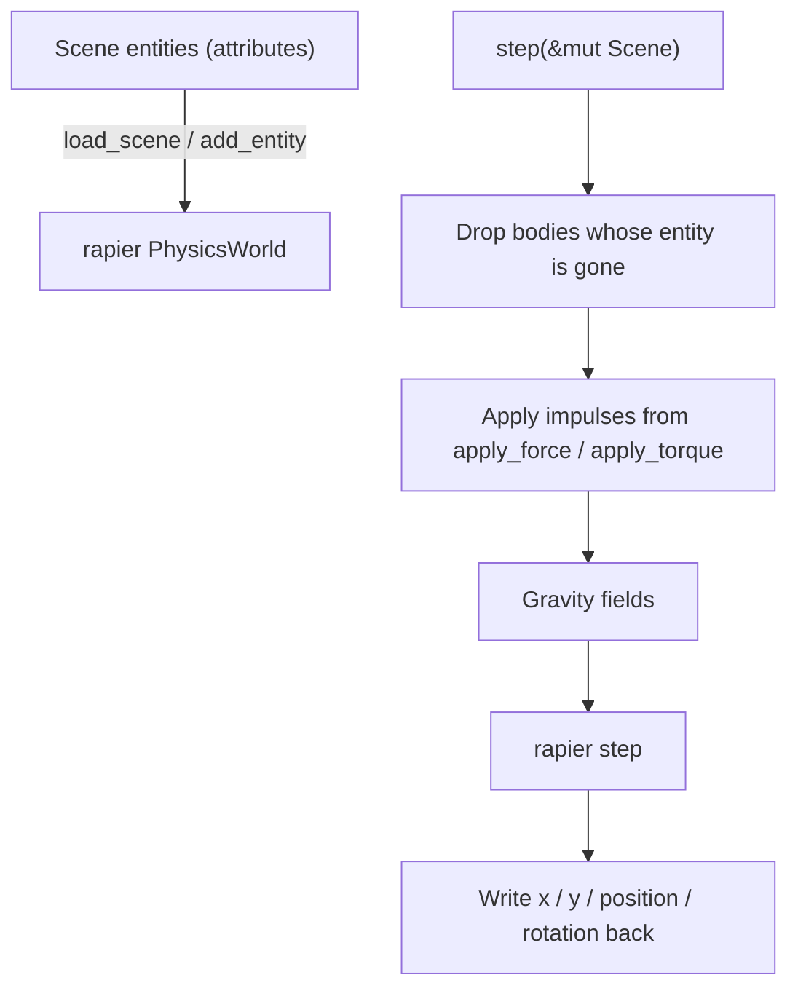

# Physics (`src/physics/`)

A wrapper around [rapier2d](https://crates.io/crates/rapier2d) that mirrors
scene entities into a physics world (rigid bodies + colliders), steps it at a
fixed timestep, and writes positions and rotations back into the entities.

Coordinates are screen-space pixels with **+Y pointing down**; the default
gravity `(0, 50)` pulls entities down the screen.

## Bodies and entities

`PhysicsEngine::add_entity(&Entity)` builds a body from the entity's
attributes, read by name:

| Attribute | Type | Default | Effect |
|---|---|---|---|
| `has_gravity` / `has_collision` / `creates_gravity` | Boolean | — | An entity takes part only if it has at least one of these |
| `is_movable` | Boolean | false | Dynamic body; otherwise fixed |
| `is_kinematic` | Boolean | false | Kinematic body, moved only by `set_velocity`; never sleeps |
| `has_gravity` | Boolean | false | Affected by global gravity and gravity fields |
| `gravity_scale` | Float | 1.0 | Multiplier on global gravity |
| `has_collision` | Boolean | true | Attach a collider |
| `can_rotate` | Boolean | false | Dynamic bodies may rotate; their angle is written to `rotation` |
| `rotation` | Float (degrees) | 0 | Initial angle |
| `collider_width` / `collider_height` | Float | sprite size | Body size; otherwise the first image's pixel size (one frame's, for a sprite sheet with `frame_size`) times `scale` |
| `collider_shape` | String | `"rectangle"` | `"circle"` fits a circle inside the body size |
| `density` / `friction` / `restitution` | Float | 1.0 / 0.5 / 0.0 | Collider material |
| `is_sensor` | Boolean | false | A trigger zone: reports overlaps without pushing anything (see below) |
| `collision_layer` | Integer | 1 | The collider's layer, 1 to 32 |
| `collides_with` | String | every layer | Layers the collider interacts with, e.g. `"1,3"`; empty means every layer |
| `creates_gravity` | Boolean | false | Attract `has_gravity` bodies (see below) |
| `gravity_strength` | Float | 500000 | Field strength: acceleration is `strength / distance²` px/s² |

Re-adding an entity replaces its body. Dynamic bodies without a collider get a
mass of 1 so gravity and forces still act on them.

### Origin convention

An entity's `x`/`y` is the **top-left corner** of its sprite (what the
renderer and the editor use). The rigid body's origin is the **center** of the
body size, and the collider is centered on it, so bodies rotate around the
sprite center exactly like the renderer rotates sprites. Write-back converts
back: `x = center.x - width / 2`, `y = center.y - height / 2`.



## Per-frame use

The runtime calls, every rendered frame:

1. `begin_frame(frame_dt)` — records the real frame duration.
2. Scripts run; `apply_force` / `apply_torque` accumulate **impulses**
   (`force × frame_dt`), so a force applied every frame has the same effect at
   30, 60 or 144 fps, and a force applied in one frame is never lost.
3. `step(&mut Scene)` zero or more times (fixed timestep, default 1/60 s).
   Each step applies the pending impulses, applies gravity fields, simulates,
   and writes the results into the scene. Fixed bodies are not written back.

`cleanup()` removes every body and restores the default gravity, so changes a
script made with `set_gravity` don't carry over into the next Play.

## Trigger zones and collision layers

A **sensor** (`is_sensor = true`) is a trigger zone: other colliders pass
through it, and the overlap is reported like a contact, by
`get_colliding_entities` and by the scripts' `on_collision` /
`on_collision_end` hooks. Sensors notice every kind of body, fixed and
kinematic ones included, and a movable sensor still moves and falls (a coin
dropping from a broken box). Debug outlines draw sensors in green.

**Collision layers** decide which colliders interact at all. Every collider is
on one layer (`collision_layer`, default 1) and lists the layers it interacts
with (`collides_with`, default all). Two colliders touch, or overlap when one
is a sensor, only if each one's layer is in the other's list. Invalid values
are reported in the console and replaced by the defaults.

For example, with the player on layer 2 and bullets on layer 3 with
`collides_with = "1"`, bullets hit walls and enemies (layer 1) but pass
through the player and each other.

## Tilemaps

An entity with a tilemap (see [scene.md](scene.md#tilemaps)) gets a fixed
body with its origin at the entity's `x`/`y`, the top-left corner of cell
(0, 0); `is_movable`, `is_kinematic`, `rotation` and the collider size
attributes don't apply. With `has_collision`, the cells with a tile collide
as their tile's `TileCollision` says:

- **Solid** (the default) cells form one **voxel collider**, which keeps
  bodies sliding along a row of tiles from catching on the edges between
  them (with a box per tile they would).
- **One-way** cells form a second voxel collider, flagged for the
  `OneWayPlatforms` physics hook. It keeps a contact only when its normal
  points within 45° of straight up out of the platform, so bodies land on
  it, jump up through it from below and move through it sideways. Rapier's
  `update_as_oneway_platform` keeps a contact refused while the body still
  penetrates, so a body halfway through isn't popped on top. A refused
  contact isn't reported: a body passing through isn't colliding with the
  tilemap. `drop_through_platforms(entity)` lets a body fall through the
  one-way tiles it stands on (pressing down, in a platformer): they refuse
  its contacts until it has no contact point with any of them, and its
  contacts start out refused, so it isn't popped back on top.
- **Passable** cells don't collide (decoration).

The entity's material, `is_sensor` and collision layers apply to both
colliders; a sensor tilemap's one-way cells are part of the zone like its
solid ones. Contacts report the tilemap entity, and raycasts hit it.

`update_tilemap(entity)` rebuilds a tilemap's colliders after its tiles, or
how they collide, changed (scripts' `set_tile` calls it) and wakes the
bodies that touched them, so none stays floating where a tile was removed.
Debug outlines draw a square per solid tile and the top edge of each one-way
tile.

## Raycasts

`raycast(from, to, exclude)` returns the first collider the segment from
`from` to `to` hits as a `RayHit` (`entity_id`, world `point`, and `distance`
from `from`), or `None`. Sensors are ignored, and so is the body of `exclude`:
pass the entity casting the ray, which a ray starting inside it would hit at
distance 0. Queries see the colliders as of the last `step`, so a body added
since isn't found yet.

## Gravity fields

Every `creates_gravity` entity attracts every dynamic `has_gravity` body
towards its body center (or its `x`/`y` if it has no body) with acceleration
`gravity_strength / distance²`, independent of the attracted body's mass.
Distances below 10 px count as 10 px.

## Public API

- **Lifecycle**: `new`, `add_entity`, `remove_entity`, `load_scene`,
  `begin_frame`, `step`, `cleanup`, `update_tilemap`
- **World**: `set_gravity` / `get_gravity`, `set_time_step` / `get_time_step`
- **Bodies**: `get_velocity` / `set_velocity`, `apply_force`, `apply_impulse`,
  `set_position` (teleport, keeps velocity), `body_center` (the body's
  position: its collider's middle, which the camera follows), `get_angular_velocity` /
  `set_angular_velocity`, `apply_torque`, `drop_through_platforms`
- **Queries**: `get_colliding_entities` (entities currently touching, or
  overlapping when either is a sensor), `raycast`, `collider_outlines` (debug
  drawing), `has_rigid_body`, `has_collider`,
  `is_empty`, `rigid_body_count`

Vectors are `(f32, f32)` tuples; rapier types don't appear in the API.

```rust
let mut physics = PhysicsEngine::new();
physics.load_scene(&scene);

// every frame
physics.begin_frame(frame_dt);
physics.apply_force(player_id, (0.0, -300.0));
physics.step(&mut scene); // as many times as the fixed timestep requires

let touching = physics.get_colliding_entities(player_id);
```

## Known limitations

- Attributes are read by name with linear lookups when a body is created and
  when results are written back.
- Gravity fields are O(sources × bodies) per step.
- Joints, continuous collision detection settings and shape casts are not
  exposed; raycasts can exclude one entity only.
- `raycast` doesn't see bodies added since the last `step`.
- A tilemap's colliders are rebuilt whole when a tile changes, which gets
  slow for very large maps changing every frame.
- One-way tiles only face up, and raycasts hit them from every side.
- `load_scene` adds only a scene's local entities; shared entities are
  ignored.
- Changing a physics attribute while playing has no effect until the entity is
  re-added (`add_entity_to_physics_engine` in scripts).
