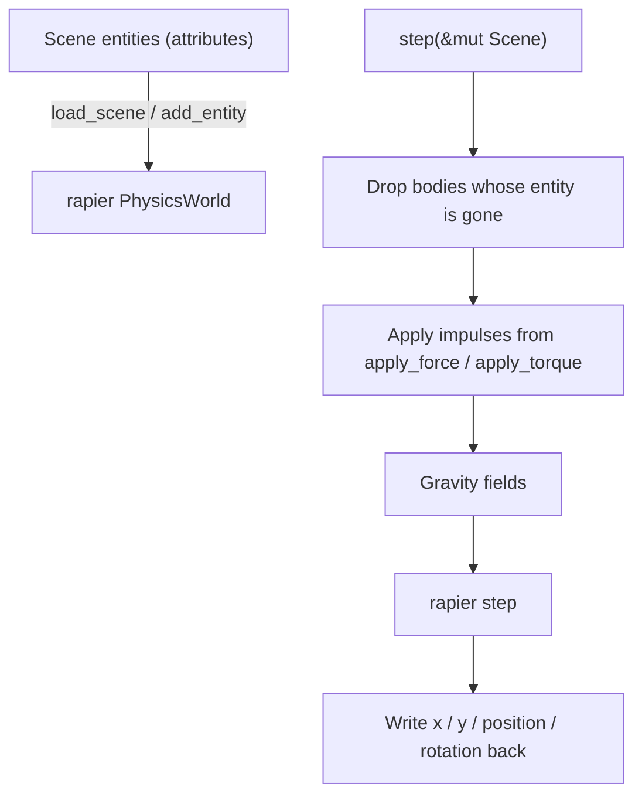

# Physics (`src/physics/`)

A wrapper around [rapier2d](https://crates.io/crates/rapier2d) that mirrors
scene entities into a physics world (rigid bodies + colliders), steps it at a
fixed timestep, and writes positions and rotations back into the entities.

Coordinates are screen-space pixels with **+Y pointing down**; the default
gravity `(0, 50)` pulls entities down the screen.

## Bodies and entities

`PhysicsEngine::add_entity(&Entity)` builds a body from the entity's
attributes, read by name:

| Attribute | Type | Default | Effect |
|---|---|---|---|
| `has_gravity` / `has_collision` / `creates_gravity` | Boolean | — | An entity takes part only if it has at least one of these |
| `is_movable` | Boolean | false | Dynamic body; otherwise fixed |
| `is_kinematic` | Boolean | false | Kinematic body, moved only by `set_velocity`; never sleeps |
| `has_gravity` | Boolean | false | Affected by global gravity and gravity fields |
| `gravity_scale` | Float | 1.0 | Multiplier on global gravity |
| `has_collision` | Boolean | true | Attach a collider |
| `can_rotate` | Boolean | false | Dynamic bodies may rotate; their angle is written to `rotation` |
| `rotation` | Float (degrees) | 0 | Initial angle |
| `collider_width` / `collider_height` | Float | sprite size | Body size; otherwise the first image's pixel size (one frame's, for a sprite sheet with `frame_size`) times `scale` |
| `collider_shape` | String | `"rectangle"` | `"circle"` fits a circle inside the body size |
| `density` / `friction` / `restitution` | Float | 1.0 / 0.5 / 0.0 | Collider material |
| `creates_gravity` | Boolean | false | Attract `has_gravity` bodies (see below) |
| `gravity_strength` | Float | 500000 | Field strength: acceleration is `strength / distance²` px/s² |

Re-adding an entity replaces its body. Dynamic bodies without a collider get a
mass of 1 so gravity and forces still act on them.

### Origin convention

An entity's `x`/`y` is the **top-left corner** of its sprite (what the
renderer and the editor use). The rigid body's origin is the **center** of the
body size, and the collider is centered on it, so bodies rotate around the
sprite center exactly like the renderer rotates sprites. Write-back converts
back: `x = center.x - width / 2`, `y = center.y - height / 2`.



## Per-frame use

The runtime calls, every rendered frame:

1. `begin_frame(frame_dt)` — records the real frame duration.
2. Scripts run; `apply_force` / `apply_torque` accumulate **impulses**
   (`force × frame_dt`), so a force applied every frame has the same effect at
   30, 60 or 144 fps, and a force applied in one frame is never lost.
3. `step(&mut Scene)` zero or more times (fixed timestep, default 1/60 s).
   Each step applies the pending impulses, applies gravity fields, simulates,
   and writes the results into the scene. Fixed bodies are not written back.

`cleanup()` removes every body and restores the default gravity, so changes a
script made with `set_gravity` don't carry over into the next Play.

## Gravity fields

Every `creates_gravity` entity attracts every dynamic `has_gravity` body
towards its body center (or its `x`/`y` if it has no body) with acceleration
`gravity_strength / distance²`, independent of the attracted body's mass.
Distances below 10 px count as 10 px.

## Public API

- **Lifecycle**: `new`, `add_entity`, `remove_entity`, `load_scene`,
  `begin_frame`, `step`, `cleanup`
- **World**: `set_gravity` / `get_gravity`, `set_time_step` / `get_time_step`
- **Bodies**: `get_velocity` / `set_velocity`, `apply_force`, `apply_impulse`,
  `set_position` (teleport, keeps velocity), `get_angular_velocity` /
  `set_angular_velocity`, `apply_torque`
- **Queries**: `get_colliding_entities` (entities currently touching),
  `collider_outlines` (debug drawing), `has_rigid_body`, `has_collider`,
  `is_empty`, `rigid_body_count`

Vectors are `(f32, f32)` tuples; rapier types don't appear in the API.

```rust
let mut physics = PhysicsEngine::new();
physics.load_scene(&scene);

// every frame
physics.begin_frame(frame_dt);
physics.apply_force(player_id, (0.0, -300.0));
physics.step(&mut scene); // as many times as the fixed timestep requires

let touching = physics.get_colliding_entities(player_id);
```

## Known limitations

- Attributes are read by name with linear lookups when a body is created and
  when results are written back.
- Gravity fields are O(sources × bodies) per step.
- Joints, continuous collision detection settings, and raycasts are not
  exposed.
- `load_scene` adds only a scene's local entities; shared entities are
  ignored.
- Changing a physics attribute while playing has no effect until the entity is
  re-added (`add_entity_to_physics_engine` in scripts).
