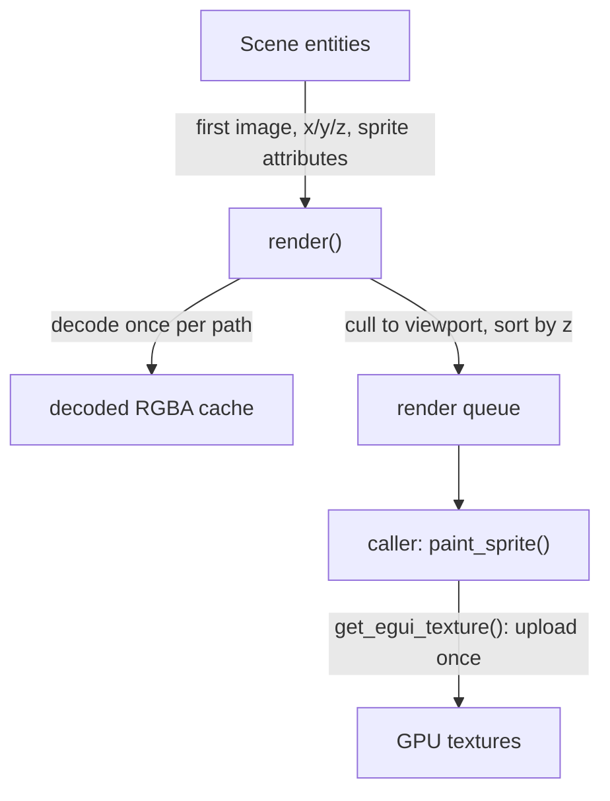

# Rendering (`src/render/`)

Sprite rendering on top of the **egui painter**. `RenderEngine::render(scene)`
turns a scene into a z-sorted queue of draw commands in viewport-relative
screen space; callers paint them with `paint_sprite`, using GPU textures from
`get_egui_texture`. Both the editor viewport and the runtime work this way.

## Key pieces

| Item | Responsibility |
|---|---|
| `Camera` | `position` = world point at the viewport's top-left, `zoom` = screen pixels per world unit; `world_to_screen` |
| `RenderEngine` | Owns a `Camera`, the viewport size, and caches of decoded images and GPU textures keyed by file path (`path_to_uuid`) |
| `RenderQueueEntry` | One sprite: entity, texture, screen position and size, rotation (radians), z |
| `paint_sprite` | Draws a textured rect, rotated around its center if needed |
| `game_view(scene, viewport_size)` | Fits the scene's default camera into a viewport (see below) |
| `render_colliders` / `paint_collider_outline` | Debug outlines of physics colliders, rotated with their bodies |

## Sprites

- An entity's sprite is its **first** image; `x`/`y` is the sprite's top-left
  corner. Its size is the image's pixel size times the optional `scale`
  Vector2 attribute times the camera zoom.
- Optional attributes change how the sprite is drawn, in the editor and in
  games:

  | Attribute | Type | Effect |
  |---|---|---|
  | `rotation` | Float (degrees) | Rotates around the sprite's center (the physics engine writes it for rotating bodies) |
  | `scale` | Vector2 | Multiplies the size |
  | `flip_x` / `flip_y` | Boolean | Mirrors the image horizontally / vertically (e.g. a character facing left) |
  | `opacity` | Float | 1 is opaque, 0 invisible; values outside 0–1 are clamped |
  | `tint` | String | `"#rrggbb"` or `"#rrggbbaa"`: multiplies the image's colors (white leaves it unchanged); an invalid value is reported once and ignored |

  A value of another type is ignored. Scripts change them with
  `set_attribute` once the entity has them (added in the Inspector, or with
  `create_attribute_*`).
- Lower `z` is drawn first. The sort is total, so a NaN `z` can't break it.
- Images that fail to load are skipped and reported once in the console; they
  are retried only after the cache is cleared.
- Images larger than the GPU's maximum texture size are downscaled on upload
  (they still cover their full size on screen).

## Game camera

`camera_frame(scene)` describes the frame the scene's default camera entity
shows:

- The camera entity's `x`/`y` is the **center** of its frame; the frame shows
  `width / zoom` × `height / zoom` world units (`width`, `height` and `zoom`
  are attributes of the camera entity): `world_min` and `world_size`.
- `size` is the camera's `width` × `height`: the frame's size in its own
  pixels, whatever the zoom. Text drawn over the game is laid out in this
  space.

`game_view(scene, viewport_size)` fits that frame into a viewport: scaled
uniformly and centered; the returned `frame` rect is the part of the viewport
it covers (the rest is letterboxing). The runtime uses it for exported games;
the editor draws the same frame as a red rectangle (`get_game_camera_bounds`).

## Text

`HudText` is one text drawn over the game: its string, position (the top of
the text, in camera frame pixels), font height, color and horizontal
alignment (`TextAlign`). `paint_texts(painter, texts, origin, scale)` draws
them with egui's built-in fonts, given the screen position of the camera
frame's top-left corner and the screen pixels per frame pixel, so text scales
with the game. Texts smaller than one screen pixel are skipped.

`parse_color("#rrggbb")` / `parse_color("#rrggbbaa")` reads the color strings
scripts use.

## Caches

`clear_cache()` drops decoded images, GPU textures and remembered load
failures; `unload_texture(path)` does so for one file; `cleanup()` also resets
the camera. Images are not reloaded automatically when their file changes on
disk.

## Known limitations

- The camera entity's `rotation` attribute is not applied.
- Text uses egui's built-in fonts (plus system fonts for missing glyphs);
  projects can't bring their own, and text can't be measured from scripts.
- Text is always drawn over the sprites, in camera frame space; there is no
  text placed in the world (e.g. a label following an entity).
- The same image referenced through two different path spellings is cached
  twice.
- The editor and the runtime each own a `RenderEngine`, so images used in
  both are decoded and uploaded twice.
