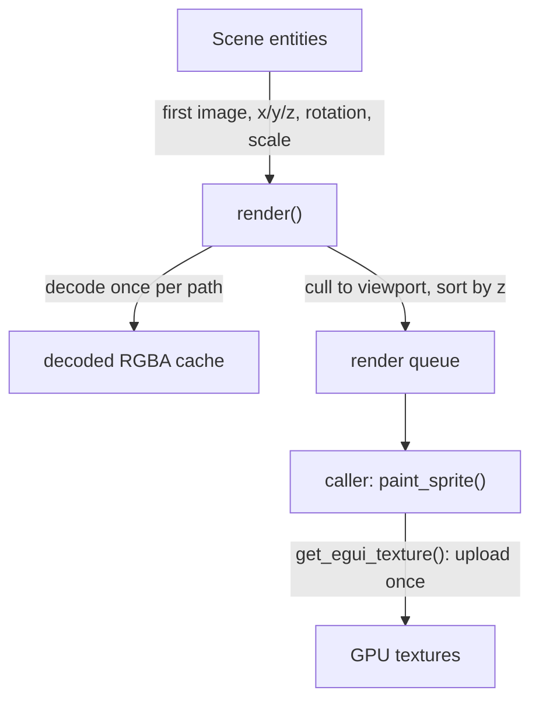

# Rendering (`src/render/`)

Sprite rendering on top of the **egui painter**. `RenderEngine::render(scene)`
turns a scene into a z-sorted queue of draw commands in viewport-relative
screen space; callers paint them with `paint_sprite`, using GPU textures from
`get_egui_texture`. Both the editor viewport and the runtime work this way.

## Key pieces

| Item | Responsibility |
|---|---|
| `Camera` | `position` = world point at the viewport's top-left, `zoom` = screen pixels per world unit; `world_to_screen` |
| `RenderEngine` | Owns a `Camera`, the viewport size, and caches of decoded images and GPU textures keyed by file path (`path_to_uuid`) |
| `RenderQueueEntry` | One sprite: entity, texture, screen position and size, rotation (radians), z |
| `paint_sprite` | Draws a textured rect, rotated around its center if needed |
| `game_view(scene, viewport_size)` | Fits the scene's default camera into a viewport (see below) |
| `render_colliders` / `paint_collider_outline` | Debug outlines of physics colliders, rotated with their bodies |

## Sprites

- An entity's sprite is its **first** image; `x`/`y` is the sprite's top-left
  corner. Its size is the image's pixel size times the optional `scale`
  Vector2 attribute times the camera zoom.
- The optional `rotation` Float attribute (degrees) rotates the sprite around
  its center (the physics engine writes it for rotating bodies).
- Lower `z` is drawn first. The sort is total, so a NaN `z` can't break it.
- Images that fail to load are skipped and reported once in the console; they
  are retried only after the cache is cleared.
- Images larger than the GPU's maximum texture size are downscaled on upload
  (they still cover their full size on screen).

## Game camera

`game_view(scene, viewport_size)` turns the scene's default camera entity
into a render camera:

- The camera entity's `x`/`y` is the **center** of its frame; the frame shows
  `width / zoom` × `height / zoom` world units (`width`, `height` and `zoom`
  are attributes of the camera entity).
- The frame is scaled uniformly to fit the viewport and centered; the
  returned `frame` rect is the part of the viewport it covers (the rest is
  letterboxing).

The runtime uses it for exported games; the editor draws the same frame as a
red rectangle (`get_game_camera_bounds`).

## Caches

`clear_cache()` drops decoded images, GPU textures and remembered load
failures; `unload_texture(path)` does so for one file; `cleanup()` also resets
the camera. Images are not reloaded automatically when their file changes on
disk.

## Known limitations

- The camera entity's `rotation` attribute is not applied.
- The same image referenced through two different path spellings is cached
  twice.
- The editor and the runtime each own a `RenderEngine`, so images used in
  both are decoded and uploaded twice.
