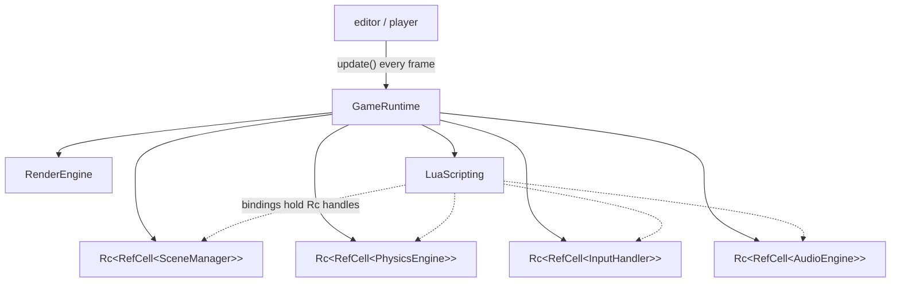

# Runtime (`src/runtime/`)

`GameRuntime` owns play mode: the state machine, the per-frame game loop, and
the plumbing between scenes, scripts, physics, audio and rendering. The editor
and the standalone player ([`src/player.rs`](../src/player.rs)) call
`update(ctx, ui, viewport_rect)` every frame, which is:

1. feed egui's input into the `InputHandler` (see below),
2. `tick(frame_dt)` — advance the simulation (headless, used directly by tests),
3. `paint(ui, viewport_rect)` — draw the scene (skipped when stopped).

## Input

`update` registers a click-only "game surface" widget over the viewport, and
gives the game:

- the keyboard, unless another egui widget has keyboard focus (in the
  editor: a text field);
- mouse buttons and the scroll wheel while the surface is the topmost widget
  under the pointer, or a press that started on it is held. Widgets added
  later in the frame, like the editor's play buttons, and windows above it
  keep their clicks.

Then come the frame's gamepad events (see [input.md](input.md#gamepads)):
the system's gamepads, once `set_gamepads(true)` was called (exported games
and the editor do it; the gamepads open at the next `update`), and those
queued with `queue_gamepad_events`, e.g. by tests.

The project's input actions (see [input.md](input.md#input-actions)) are
given with `set_input_actions`; every `run()` hands them to the
`InputHandler` again, so bindings scripts changed with
`set_action_bindings` last only until the game stops.

It then maps the pointer's window position through the camera that paints
this frame (the free camera, or the game camera fitted into the viewport) and
records it in the `InputHandler`: in world coordinates, and in the camera
frame's pixels, the space `draw_text` lays text out in. `input()` returns the
handler, e.g. for tests.

## Ownership

The scene manager, physics engine, input handler and audio engine are
`Rc<RefCell<…>>` because Lua bindings hold handles to them (see
[scripting.md](scripting.md)). The `RenderEngine` is a plain field.
`get_scene_manager()`, `input()`, `audio()`, `render_engine()` and
`scripting()` lend them out, e.g. for tests.

## State machine

| Call | From → to | What happens |
|---|---|---|
| `run()` | Stopped → Playing | Activates the first scene if none is active, remembers the scenes' initial state, loads a fresh physics world (default gravity), starts a fresh Lua session, restores the project's input actions. Running from another state resets first |
| `pause()` / `resume()` | Playing ⇄ Paused | Simulation and audio freeze; the scene keeps rendering |
| script calls `end_game()` | Playing → Ended | Sounds stop and the last frame stays visible |
| `reset()` | any → Stopped | Physics, render caches and audio cleared; scenes restored to their initial state |
| `restart()` | any → Playing | `reset()` then `run()` (the player's "play again") |

## One tick (while Playing)

1. The frame time is capped at 5 physics steps (1/12 s at 60 Hz). Slower
   frames run the whole game in slow motion, so scripts and physics always
   see the same time. A scene transition under way moves on by it, and
   halfway through changes the scene before the frame plays (see
   [below](#switching-scenes)).
2. `physics.begin_frame(frame_dt)` — forces scripts apply this frame act for
   this frame's duration.
3. Input actions are worked out from the frame's input
   (`InputHandler::update_actions`), then Lua: `accumulated_time +=
   frame_dt`, `keys_pressed` refreshed, timers that came due fire and tweens
   move on (see [scripting.md](scripting.md#timers-and-tweens)), the camera
   moves as `camera_follow` and `camera_shake` say (to where the entity it
   follows got in the last frame; see
   [render.md](render.md#following-shaking-and-transitions)), and every
   scripted entity's `update` runs (once per rendered frame), seeing the
   camera where it will be painted.
4. Physics runs as many fixed steps (`1/target_fps`) as the accumulated time
   allows. After **each step**, `on_collision_end` and `on_collision` fire for
   the contacts that step ended and started, so short contacts aren't missed
   between frames.
5. Sprite sheet animations advance by the frame time, and so do particles,
   adding the bursts scripts asked for (see
   [render.md](render.md#particles)), and animated tiles.
6. Finished sounds are reaped.

When a script calls `end_game()` or `change_scene()`, the request takes
effect as soon as the pass of hooks that made it finishes (step 3, or one
physics step's collision hooks), and the rest of the tick is skipped; a
`change_scene` with a transition starts the transition instead, and the
tick goes on. Script
errors are logged to the editor console and never stop the loop.

## Switching scenes

A game can span several scenes: a title screen, levels, a game-over screen.
`switch_scene(scene_id)`, which the `change_scene` script binding triggers,
makes another scene the active one while the game runs:

- The scene is replaced by a copy of how it was when the game started, so
  every visit starts it over; switching to the current scene restarts it.
- A new physics world is loaded from it, keeping the current gravity.
- Its scripted entities run `init` again, and their contacts and drawn text
  start empty (`LuaScripting::begin_scene`).
- The Lua session carries over: `script_state`, the scripts' variables, and
  the sounds that are playing.

The scene that was left keeps its state until it is entered again. `reset()`
restores every scene, and which one is active, to how they were at `run()`.
`switch_scene` fails when the game is stopped or the scene doesn't exist.

`change_scene_with(scene_id, Transition)`, which `change_scene` triggers when
given options, goes there through a transition (see
[render.md](render.md#following-shaking-and-transitions)): its color covers
the camera frame over the first half of its time, the scene changes as
above at the midpoint, at the start of a tick, and the new scene shows over
the second half. Both scenes play meanwhile: the old one until it's
covered, the new one from the midpoint. While the frame is being covered,
other changes with a transition are ignored, so a button pressed twice
doesn't change the scene twice; once the new scene shows, another one
covers it again from where the transition is. A change without a transition
(`switch_scene`) calls a transition off, and so do `reset()` and `run()`.
`transition_coverage()` says how much of the frame is covered (0 without a
transition).

## Save data

The runtime owns the game's `SaveData` (see [save.md](save.md)) and shares it
with every scripting session, so it outlives Stop and Play. A new runtime
keeps it in memory; `set_save_data` points it at a file (the player uses the
user's data folder, the editor the project's `saves/` folder), and
`save_data()` gives access, e.g. to clear it.

## Painting and cameras

`set_camera_mode` picks the view:

- `CameraMode::Game` (default, used by exported games): the scene's default
  camera entity, scaled to fit the viewport and letterboxed with black bars
  (see `render::game_view`).
- `CameraMode::Free { position, zoom }`: a camera controlled by the caller.
  The editor shows play mode through its own pan/zoom camera and draws the
  game camera's frame as a red rectangle.

Sprites, then what scripts drew over the game this frame (text,
rectangles, images and buttons, laid out in the camera frame; see
[render.md](render.md#text-and-game-ui)), then a scene transition under way
are clipped to the visible area.
What scripts draw is collected while they run and cleared when the next
frame's scripts start, so a paused or ended game keeps showing it.

Collider outlines (a debugging aid) are drawn on top only after
`set_show_colliders(true)`: exported games never show them, and the editor
shows them while playing unless View → Collider Outlines is unchecked.

## Known limitations

- Scripts run once per rendered frame, so per-frame counters depend on the
  refresh rate; use `accumulated_time` for timing.
- Shared entities (`SceneManager::shared_entities`) never reach physics or
  scripts.
- In the editor, the game only advances while the Viewer tab is shown.
- Every scene stays in memory twice while playing: as played, and as it was
  at `run()`.
- Scripts can't tell whether a transition is under way, and the scene
  being left keeps playing until it's covered.
