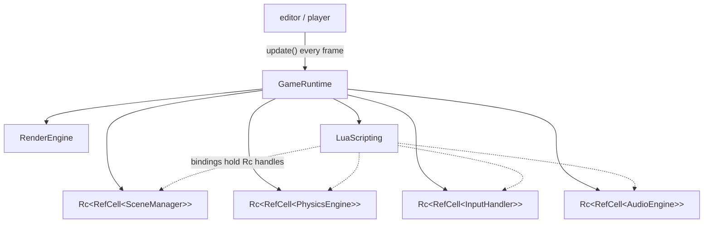

# Runtime (`src/runtime/`)

`GameRuntime` owns play mode: the state machine, the per-frame game loop, and
the plumbing between scenes, scripts, physics, audio and rendering. The editor
and the standalone player ([`src/player.rs`](../src/player.rs)) call
`update(ctx, ui, viewport_rect)` every frame, which is:

1. feed egui's input into the `InputHandler`,
2. `tick(frame_dt)` — advance the simulation (headless, used directly by tests),
3. `paint(ui, viewport_rect)` — draw the scene (skipped when stopped).

## Ownership

The scene manager, physics engine, input handler and audio engine are
`Rc<RefCell<…>>` because Lua bindings hold handles to them (see
[scripting.md](scripting.md)). The `RenderEngine` is a plain field.

## State machine

| Call | From → to | What happens |
|---|---|---|
| `run()` | Stopped → Playing | Activates the first scene if none is active, remembers the scenes' initial state, loads a fresh physics world (default gravity), starts a fresh Lua session. Running from another state resets first |
| `pause()` / `resume()` | Playing ⇄ Paused | Simulation and audio freeze; the scene keeps rendering |
| script calls `end_game()` | Playing → Ended | Detected after the scripts or after a physics step; sounds stop and the last frame stays visible |
| `reset()` | any → Stopped | Physics, render caches and audio cleared; scenes restored to their initial state |
| `restart()` | any → Playing | `reset()` then `run()` (the player's "play again") |

## One tick (while Playing)

1. The frame time is capped at 5 physics steps (1/12 s at 60 Hz). Slower
   frames run the whole game in slow motion, so scripts and physics always
   see the same time.
2. `physics.begin_frame(frame_dt)` — forces scripts apply this frame act for
   this frame's duration.
3. Lua: `accumulated_time += frame_dt`, `keys_pressed` refreshed, every
   scripted entity's `update` runs (once per rendered frame).
4. Physics runs as many fixed steps (`1/target_fps`) as the accumulated time
   allows. After **each step**, `on_collision` fires for contacts that step
   started, so short contacts aren't missed between frames.
5. Finished sounds are reaped.

Script errors are logged to the editor console and never stop the loop.

## Painting and cameras

`set_camera_mode` picks the view:

- `CameraMode::Game` (default, used by exported games): the scene's default
  camera entity, scaled to fit the viewport and letterboxed with black bars
  (see `render::game_view`).
- `CameraMode::Free { position, zoom }`: a camera controlled by the caller.
  The editor shows play mode through its own pan/zoom camera and draws the
  game camera's frame as a red rectangle.

Sprites are clipped to the visible area. Collider outlines (a debugging aid)
are drawn on top only after `set_show_colliders(true)`: exported games never
show them, and the editor shows them while playing unless View → Collider
Outlines is unchecked.

## Known limitations

- Scripts run once per rendered frame, so per-frame counters depend on the
  refresh rate; use `accumulated_time` for timing.
- Shared entities (`SceneManager::shared_entities`) never reach physics or
  scripts.
- In the editor, the game only advances while the Viewer tab is shown.
