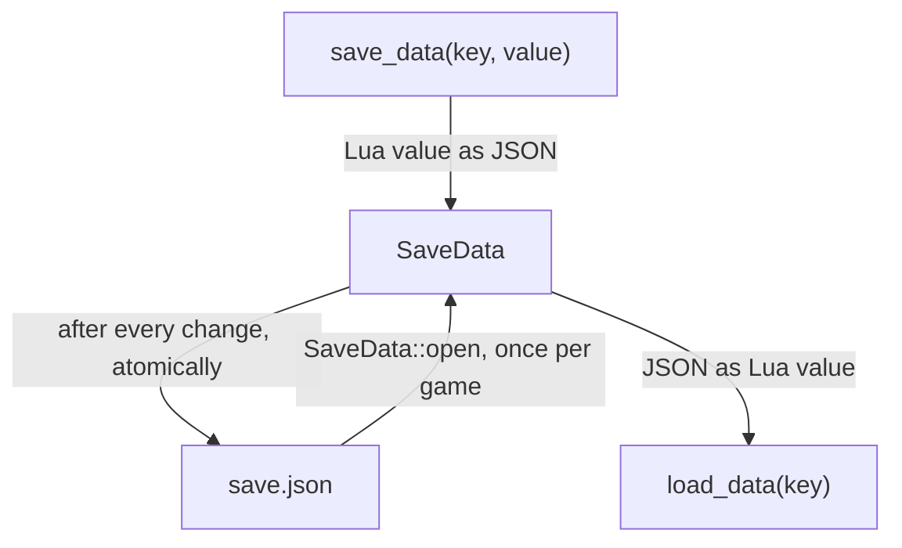

# Save Data (`src/save/`)

Values a game keeps between runs: high scores, unlocked levels, settings.
Scripts call `save_data(key, value)` and `load_data(key)` (see
[scripting.md](scripting.md)); the engine keeps them in one JSON file per
game.

## Where it is stored

| Who plays | File |
|---|---|
| An exported game | `save.json` in a folder named after the game (the title passed to `player::run`) in the user's data folder: `%APPDATA%` on Windows, `~/Library/Application Support` on macOS, `$XDG_DATA_HOME` or `~/.local/share` elsewhere |
| The editor | `saves/save.json` in the project, so playtests don't mix with the saves of a released game; Project → Clear Save Data deletes it |
| A `GameRuntime` nobody configured (tests) | Memory only |

`game_data_dir(name)` computes the exported game's folder: characters that
can't be in a folder name become `_`, and an empty name becomes `game`. It is
`None` when the environment names no user data folder; save data then lives
in memory, and a warning says so.

## `SaveData`

- `SaveData::open(path)` reads the file if it exists. A file that isn't a
  JSON object is renamed to `save.json.corrupt` and reported, so the next
  save doesn't destroy what may still be recovered; the game starts with no
  saved values.
- `SaveData::for_game(name)` opens the file in `game_data_dir(name)`;
  `SaveData::in_memory()` never touches the disk.
- `get(key)` and `set(key, Some(value) | None)`: every `set` writes the whole
  file (through a temporary file renamed over it, so a crash can't truncate
  it), creating its folder. A change that would make the file larger than
  `MAX_SAVE_SIZE` (1 MiB) is refused with `SaveError::TooLarge`; when only
  writing fails, `SaveError::Io` is returned and the value stays in memory.
- `clear()` removes every value and the file.

The runtime owns the game's `SaveData` (`GameRuntime::set_save_data`,
`save_data()`) and shares it with the scripting session; it survives Stop and
Play, so a game played again in the editor finds what it saved.

## Values

`save_data` stores booleans, numbers (integers stay integers), strings, and
tables that are lists or have string keys, nested up to 32 levels. Functions,
NaN and infinite numbers, tables mixing list and string keys, sparse lists and
tables containing themselves raise an error. `nil` removes the key.

## Known limitations

- Every `save_data` call writes the whole file; saving many values every frame
  is slow.
- One save file per game: no save slots, unless scripts put them under
  different keys.
- Two exported games with the same title share their save data.
