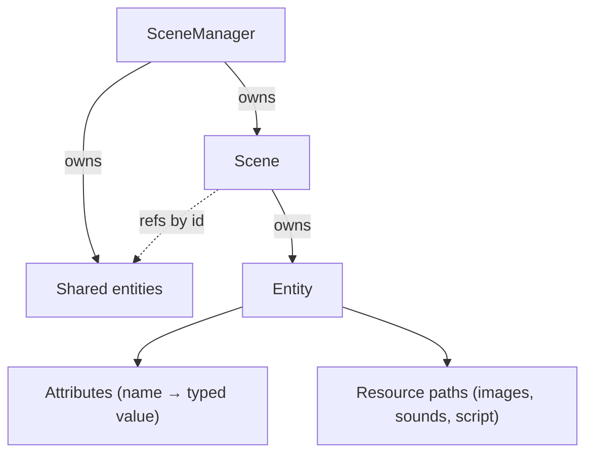

# Scene (`src/scene/`)

The engine's data model. It is **not** an archetype/columnar ECS: there are no
component tables or systems. A `SceneManager` owns `Scene`s, a `Scene` owns
`Entity`s, and an `Entity` is a bag of named, typed `Attribute`s plus lists of
resource paths (images, sounds, one script). Engine systems recognize entities
by the attributes they carry (physics reads `has_gravity`, the renderer reads
`x`/`y`/`z`, …). Everything serializes with serde; `IndexMap`s keep a
deterministic order in memory and on disk.



## Types

| Type | Responsibility |
|---|---|
| `SceneManager` | Scenes (keyed by their id), cross-scene shared entities, the active scene |
| `Scene` | Entities and shared-entity references; creates a `main_camera` entity on construction (`default_camera`) |
| `Entity` | `id`, `name`, `attributes`, `images`, `sounds`, `script` |
| `Attribute` | `{id, name, data_type, value}` |
| `AttributeType` / `AttributeValue` | `Integer(i32)`, `Float(f32)`, `String`, `Boolean(bool)`, `Vector2(f32, f32)` |
| `PhysicsProperties` | Settings for `Entity::new_physical` / `Scene::create_physical_entity` |
| `PHYSICS_ATTRIBUTES` | The editor's "Physics" template (also used by the `create_physical_entity` script binding); `Entity::add_physics_attributes` applies it |

Entities are specialized only by attributes:

- Every entity has `x`, `y` (the sprite's top-left corner) and `z` (draw
  order) Float attributes, which can't be deleted or renamed.
- Cameras (`Entity::new_camera`) add `width`, `height`, `zoom`, `rotation`
  and `is_camera`. While `is_camera` is true these can't be deleted, and
  `is_camera` can't be modified.
- Physical entities add the physics attributes described in
  [physics.md](physics.md).
- Sprites read optional attributes such as `scale`, `flip_x` or `opacity`
  (see [render.md](render.md)).

Typed getters (`get_bool`, `get_float`, `get_string`, `get_vector2`) read such
optional attributes, returning `None` when one is missing or has another type;
`set_or_create_attribute` sets one, creating it if needed. They look attributes
up with `attribute(name)`, which, unlike `get_attribute_by_name`, builds no
error message for a missing attribute: engine systems check optional
attributes of every entity every frame.

**Attribute presets** (`attribute_presets()`, in `archetype.rs` next to the
Physics template) are named sets of such attributes that turn on a feature,
with working default values: a trigger zone, collision layers, a sprite sheet
animation, a tint, a particle emitter, … Each has a group ("Physics",
"Sprite", "Animation", "Effects"), a name and a one-line description. `Entity::apply_preset` adds the preset's
attributes the entity lacks (existing ones keep their values) and returns how
many it added; `has_preset` tells whether the entity has them all. The editor
lists them in the inspector's Add Feature menu.

## Tilemaps

An entity can carry a **tilemap** (`Entity::tilemap`, a boxed `Tilemap`, so
entities without one stay small) instead of a sprite: a grid of tiles drawn
from one **tileset** image, which is cut into `tile_size` cells numbered from
0 left to right, then top to bottom (like a sprite sheet). Cell (0, 0) has its
top-left corner at the entity's `x`/`y`; columns grow to the right and rows
downwards, and cells can have negative coordinates.

- `get(column, row)` and `set(column, row, Some(tile) | None)`; the grid grows
  to include every cell that gets a tile, up to `MAX_TILEMAP_SIDE` (1024)
  columns and rows. Columns and rows go from `-MAX_TILEMAP_COORDINATE` to
  `MAX_TILEMAP_COORDINATE` (1,048,576): farther out, world positions lose
  precision and physics' voxel coordinates would overflow. `set` reports
  whether the cell changed, and refuses cells it can't add; scene files with
  cells out of range fail to load.
- `fill_rect(columns, rows, tile)` puts a tile (or with `None`, nothing) in
  every cell of a rectangle, given as its columns' and rows' ranges (both
  inclusive, either way round); a rectangle the grid can't take changes
  nothing. `flood_fill(column, row, tile)` is a paint bucket: the cell and
  every cell connected to it through sides (not corners) that holds what it
  holds, within `bounds()`; a cell beyond them fills nothing. Both return the
  cells that changed, for the physics engine to update just those.
- `tiles()` iterates the cells with tiles, `tiles_in(columns, rows)` those of a
  range of cells (what's visible), `tile_count()` counts them,
  `tile_count_bound()` is an upper bound that costs nothing to compute (the
  grid's size), and `cell_at(map_position, world)` gives the cell containing
  a world position.
- `bounds()` is the area with tiles; `grid_bounds()`, the grid the map has
  grown to, costs nothing to compute.
- `tile_collision(tile)` and `set_tile_collision(tile, collision)`: how the
  cells with a tile of the tileset collide, a `TileCollision`: `Solid` (the
  default), `OneWay` (a platform, solid only from above) or `Passable`
  (decoration).
- `tile_animation(tile)` and `set_tile_animation(tile, Some(animation) |
  None)`: a tile of the tileset shown as other tiles in turn, a
  `TileAnimation` of frames (tile numbers, at most
  `MAX_TILE_ANIMATION_FRAMES`) and a speed in frames per second (water,
  torches, grass in the wind). Cells keep the tile, which decides how they
  collide and what scripts read; `shown_tile(tile, seconds)` is the tile
  drawn, and `tile_animations()` lists the animated tiles.

Scene files store the area with tiles only, a string per row with a token
per cell (`.` for an empty cell, otherwise the tile number), so maps stay
readable and diffable; `collision` lists the tiles that aren't solid, and
`animations` the animated ones, each left out when empty:

```json
"tilemap": {
  "tileset": "assets/images/tiles.png",
  "tile_size": [16, 16],
  "collision": {"4": "one_way", "7": "passable"},
  "animations": {"9": {"frames": [9, 10, 11], "fps": 4.0}},
  "origin": [0, 3],
  "rows": [". . 4 4", "1 1 1 1"]
}
```

Entities without a tilemap have no `tilemap` key. See
[render.md](render.md#tilemaps) and [physics.md](physics.md#tilemaps) for how
tilemaps are drawn and collide.

## Invariants

- A scene's `id` equals its key in `SceneManager::scenes`, and an entity's
  `id` equals its key in `Scene::entities`. `SceneManager::repair_ids` restores
  this for files written by older versions (the project loader calls it).
- Attribute names are non-empty and unique per entity.
- An attribute's value matches its `data_type`, and Float/Vector2 numbers are
  finite (JSON can't store infinity or NaN). `create_attribute` and
  `modify_attribute` enforce this; scene files that contain `null` numbers
  (written by older versions) load them as 0 with a warning.
- Deleting the active scene or the default camera, or a shared entity that a
  scene still references, is refused.

These invariants hold for code that goes through the methods; the fields are
public, so code writing them directly is responsible for keeping them.

## API overview

- **`SceneManager`**: scene CRUD (`create_scene`, `delete_scene`,
  `list_scene`, `get_scene[_mut]`, `get_scene_by_name`), shared-entity CRUD,
  active scene (`set_active_scene`, `get_active_scene[_mut]`,
  `clear_active_scene`), `repair_ids`.
- **`Scene`**: entity CRUD (`create_entity`, `delete_entity`, `list_entity`,
  `get_entity[_mut]`), `create_camera`, `create_physical_entity`, shared-entity
  references, batch attribute writes (`update_entity_attribute[s]`; a failing
  update doesn't block the others).
- **`Entity`**: resources (`add/remove/has/list/get` for images and sounds;
  `set/remove/has/get_script`, one script at most), attributes
  (`create_attribute`, `delete_attribute`, `modify_attribute`,
  `get_attribute[_mut]`, `get_attribute_by_name`, `list_attribute`), position
  (`get/set_x/y/z`, `get/set_position`), camera
  (`get/set_camera_width/height/zoom/rotation`, `set_camera_size`, `is_camera`).

```rust
let mut scene_manager = SceneManager::new();
let level_id = scene_manager.create_scene("Level_1")?;
let scene = scene_manager.get_scene_mut(level_id).ok_or("scene not found")?;

let player_id = scene.create_physical_entity(
    "Player",
    (100.0, 100.0, 0.0),
    PhysicsProperties { is_movable: true, affected_by_gravity: true, ..Default::default() },
)?;

let player = scene.get_entity_mut(player_id)?;
player.add_image(project_dir.join("assets/images/player.png"))?;
player.set_script(project_dir.join("assets/scripts/player.lua"))?;
```

## Known limitations

- Attribute lookups by name are linear scans.
- `get_x` / `get_y` / `get_z` return 0 when the attribute is missing or not a
  Float, indistinguishable from an actual 0.
- `set_script` fails if the entity already has a script (`remove_script`
  first); the script binding replaces it.
- Shared entities exist in the data model but are not used by physics,
  rendering or scripting.
